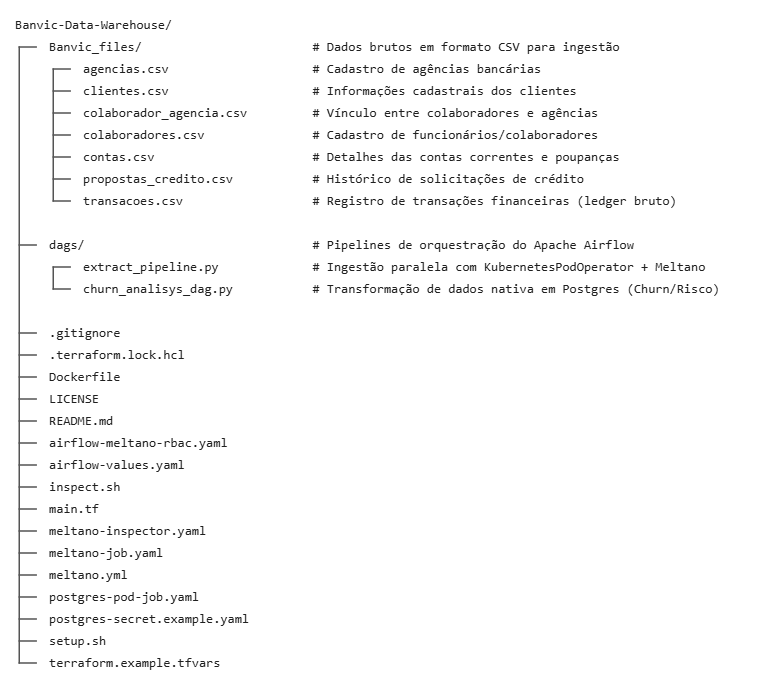

# Banvic Data Warehouse
Repositório referente à Certificação Data Engineer por Indicium AI. Este projeto provisiona a infraestrutura e orquestra o pipeline de dados para a análise de métricas de negócio do ecossistema Banvic.
## 🛠️ Pré-requisitos & Ferramentas Necessárias

*   **Git** (Controle de versão)
*   **Docker Desktop** (Com WSL2 - Windows Subsystem for Linux se estiver no Windows)
*   **Kubernetes (v1.36)** (Cluster local ativo e configurado)
*   **Helm (v3.3.0+)**
*   **Terraform (v1.16.3)**
---
## 🚀 Como Executar o Projeto

### 1. Provisionamento da Infraestrutura (Terraform)
Clone o repositório e inicialize os recursos executando as etapas na ordem abaixo:
```bash
# Clonar o repositório de dados
git clone https://github.com/mvsant/Banvic-Data-Warehouse
# Acessar a pasta raiz do projeto
cd Banvic-Data-Warehouse
# Inicializar os provedores do Terraform
terraform init
# Validar o plano de execução
terraform plan
# Aplicar a infraestrutura fornecendo o arquivo de variáveis
terraform apply -var-file="terraform.tfvars"
```
### 2. Configuração do Ambiente
Após finalizar o provisionamento da infraestrutura, execute o script de automação para configurar as dependências de cluster:
```bash
bash setup.sh
```
---
## 🔌 Encaminhamento de Portas (Port-Forward)

Para acessar as interfaces de administração e os bancos de dados locais diretamente da sua máquina, utilize os comandos do `kubectl`:
*   **Acessar a Interface do Airflow (Porta 8080):**
    ```bash
    kubectl port-forward svc/banvic-release-api-server 8080:8080 --namespace airflow
    ```
*   **Acessar o Banco de Dados Postgres (Porta 5432):**
    ```bash
    kubectl port-forward pod/banvic-database-postgres-alpine-pod 5432:5432 -n postgres
    ```
---
## 📐 Arquitetura de Dados Modelada

O Data Warehouse utiliza a modelagem dimensional (Star Schema) estruturada com as seguintes tabelas de dimensões e fatos:
Use code with caution.

[dim_clientes] [dim_agencias]
\ /
\ /
[fact_transacoes] / [fact_propostas_credito]
/ 
/ 
[dim_tempo] [dim_colaboradores]


---
## 🔄 Pipeline de Análise de Churn e Risco (Airflow DAG)

### Representação Visual do Fluxo (DAG)

graph LR
    analise_churn --> analise_risco
Linhagem de Persistência de Dados
Para garantir a resiliência e boas práticas de engenharia de dados em produção, os resultados intermediários são persistidos fisicamente no banco de dados como tabelas reutilizáveis em vez de depender inteiramente de memória volátil:

public.transacoes
|
v
analise_churn
|
v
public.analise_churn
|
v
analise_risco
|
v
public.analise_risco


> **Nota de Produção:** Esse desenho modular permite que cada tarefa produza um artefato reutilizável de forma isolada, facilitando reexecuções de tarefas específicas (*retries*) sem perda do histórico processado.


## 🧩 Extratores Modulares e Independentes (Meltano Architecture)

O pipeline de ingestão foi desenhado de forma altamente desacoplada utilizando o conceito de **herança de plugins** do Meltano. Em vez de rodar um bloco único e monolítico de ingestão, cada entidade do banco de dados possui o seu próprio extrator isolado.

### Benefícios dessa abordagem:
* **Execução Isolada**: Permite que falhas em um arquivo `.csv` específico (ex: `clientes.csv` corrompido) não interrompam nem travem a extração das outras tabelas.
* **Controle de Concorrência**: Cada entidade funciona como uma tarefa independente no Airflow, otimizando o paralelismo dentro do cluster Kubernetes.
* **Retries Cirúrgicos**: Caso a ingestão de uma tabela falhe, o Airflow reexecuta apenas o worker daquela entidade, economizando processamento e banda.

### Mapeamento de Plugins Herdados (`tap-csv`):
Todos os extratores estendem as configurações base do plugin `tap-csv`, isolando caminhos e chaves primárias (`keys`) exclusivas por entidade:

* 🏢 **Agências**: `tap-csv--agencias` (Chave: `cod_agencia`)
* 👥 **Clientes**: `tap-csv--clientes` (Chave: `cod_cliente`)
* 👔 **Colaboradores**: `tap-csv--colaboradores` (Chave: `cod_colaborador`)
* 🔗 **Vínculos**: `tap-csv--colaborador_agencia` (Chave: `cod_colaborador`)
* 💳 **Contas**: `tap-csv--contas` (Chave: `num_conta`)
* 📈 **Crédito**: `tap-csv--propostas_credito` (Chave: `cod_proposta`)
* 💸 **Transações**: `tap-csv--transacoes` (Chave: `cod_transacao`)


### 🕹️ Comando de Execução Individual

Graças ao isolamento dos componentes, você pode disparar a sincronização de qualquer entidade de forma manual ou via orquestrador usando uma sintaxe simples e direta. 

Para rodar a extração e carga de uma tabela específica (ex: `transacoes`), utilize o comando estruturado abaixo:

```bash
meltano --environment=prod run tap-csv--transacoes target-postgres
```

Este modelo garante que apenas o fluxo **Origem (`tap-csv--transacoes`) ➔ Destino (`target-postgres`)** seja processado pela engine, mantendo o pipeline rápido, previsível e fácil de debugar.

## 🏗️ Otimização e Boas Práticas na Orquestração (Airflow DAGs)

A arquitetura das DAGs deste projeto foi desenhada seguindo padrões rigorosos de engenharia de dados em produção. O uso estratégico de **sensores**, **encadeamento inteligente** e **gerenciamento de schedules** reflete diretamente na qualidade e na economia de recursos do cluster.

### 1. Sensores Modulares (`KubernetesPodOperator` como Sensor)
* **Validação Antecipada**: O sensor verifica a existência física de cada arquivo CSV no volume compartilhado antes de disparar a carga de dados.
* **Economia de Recursos**: Se um arquivo esperado estiver ausente, o pipeline falha imediatamente de forma controlada (`retries=0`), impedindo a criação de pods pesados do Meltano que falhariam por falta de insumo. Isso economiza memória e CPU no cluster.

### 2. Encadeamento Inteligente de Tarefas e Paralelismo
* **Processamento em Camadas (Tiers)**: Utilizando o conceito de `cross_downstream`, as tabelas bases independentes (como agências e colaboradores) são ingeridas em paralelo. As tabelas dependentes aguardam o momento exato para iniciar.
* **Isolamento de Erros**: Se o arquivo `clientes.csv` falhar na validação ou na carga, apenas os nós dependentes dele (como o cálculo de churn e risco) serão bloqueados. O restante do data warehouse continua sendo atualizado normalmente.

### 3. Gerenciamento Pró-Ativo de Schedule e Trigger de Eventos
* **Pipeline Baseado em Eventos**: O pipeline de extração é configurado com `schedule=None` (ou sob demanda), enquanto as transformações analíticas pós-ingestão são desacopladas. 
* **Evitando Idling (Desperdício de Recursos)**: A DAG de transformação só entra em execução quando disparada diretamente pela conclusão com sucesso da camada de ingestão. Isso elimina schedules fixos baseados em estimativas de tempo que geram concorrência desnecessária no banco de dados.

## 📂 Estrutura de Pastas do Repositório

Banvic-Data-Warehouse/
├── Banvic_files/                  # Dados brutos em formato CSV para ingestão
│   ├── agencias.csv               # Cadastro de agências bancárias
│   ├── clientes.csv               # Informações cadastrais dos clientes
│   ├── colaborador_agencia.csv    # Vínculo entre colaboradores e agências
│   ├── colaboradores.csv          # Cadastro de funcionários/colaboradores
│   ├── contas.csv                 # Detalhes das contas correntes e poupanças
│   ├── propostas_credito.csv      # Histórico de solicitações de crédito
│   └── transacoes.csv             # Registro de transações financeiras (ledger bruto)
│
├── dags/                          # Pipelines de orquestração do Apache Airflow
│   ├── extract_pipeline.py        # Ingestão paralela com KubernetesPodOperator + Meltano
│   └── churn_analisys_dag.py      # Transformação de dados nativa em Postgres (Churn/Risco)
│
├── .gitignore
├── .terraform.lock.hcl
├── Dockerfile
├── LICENSE
├── README.md
├── airflow-meltano-rbac.yaml
├── airflow-values.yaml
├── inspect.sh
├── main.tf
├── meltano-inspector.yaml
├── meltano-job.yaml
├── meltano.yml
├── postgres-pod-job.yaml
├── postgres-secret.example.yaml
├── setup.sh
└── terraform.example.tfvars

---

----

## ⚖️ Disclaimer de Desenvolvimento

Este projeto e sua documentação foram desenvolvidos utilizando assistência de Inteligência Artificial através das seguintes ferramentas:

*   **Google AI (Gemini)**: Utilizado em sua versão gratuita via browser para auxílio na estruturação de arquitetura, refatoração de códigos de orquestração (DAGs do Apache Airflow) e formatação de documentação técnica.
*   **GitHub Copilot**: Utilizado em sua versão de teste/gratuita diretamente no ambiente de desenvolvimento para autocompletar trechos de código e acelerar a escrita de scripts de infraestrutura (Terraform e YAMLs do Kubernetes).

O uso dessas ferramentas teve como objetivo otimizar o tempo de desenvolvimento e aplicar boas práticas de engenharia de dados.


