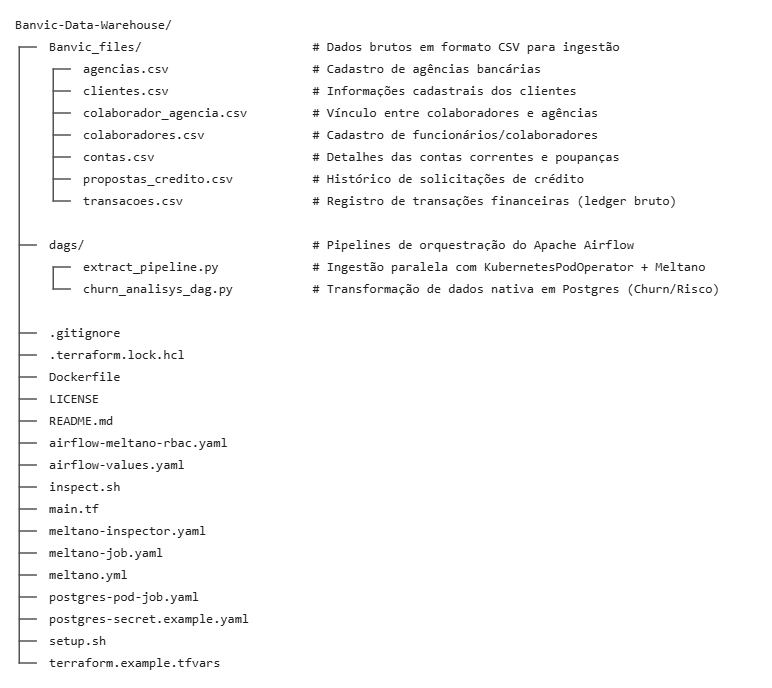

# Banvic Data Warehouse

Projeto de engenharia de dados que ingere arquivos CSV com Meltano, orquestra os pipelines com Airflow e persiste os dados em PostgreSQL.

## Estrutura

```text
airflow/       DAGs e documentação do Airflow
data/          CSVs de entrada versionados
k8s/           Manifestos e utilitários auxiliares
meltano/       Projeto Meltano com a estrutura padrão
terraform/kind/      Cluster Kind
terraform/platform/  PostgreSQL externo e Airflow Helm
scripts/       Rotinas locais de desenvolvimento
```

Os diretórios principais contêm READMEs com instruções próprias. O [guia Terraform](terraform/README.md) descreve a ordem de provisionamento.

## Persistência

PostgreSQL e Airflow são provisionados por `terraform/platform/` no Kind existente, em namespaces separados. Os dados do PostgreSQL e os logs do Airflow usam volumes no filesystem Linux do nó Kind; sobrevivem a reinícios de Pods, mas não à destruição do cluster. A persistência local não substitui backups.

As credenciais e o state são locais e ignorados pelo Git. Veja as orientações de segurança em [terraform/README.md](terraform/README.md).

## Desenvolvimento local

* O Terraform `terraform/kind/` cria o cluster Kind, carrega a imagem Meltano local e monta `airflow/dags/` do workspace no nó. Salvar uma DAG local atualiza o conteúdo visível ao Airflow sem rebuild ou `terraform apply`.
* `terraform/platform/` instala PostgreSQL, Airflow e o namespace/PVC do Meltano. Rode `bash scripts/setup.sh` para construir/carregar Meltano e copiar os CSVs locais ao PVC.
* Airflow dispara pods Meltano de curta duração. Meltano escreve no banco `banvic` usando uma credencial de privilégio mínimo; a mesma credencial é disponibilizada como conexão Airflow `Banvic_Postgres`.
* Os dados do Postgres, CSVs sincronizados e logs do Airflow persistem nos volumes do nó Kind, mas não sobrevivem à destruição do cluster. Faça backup antes de substituí-lo.
* Para acessar o Airflow:

  ```bash
  kubectl --kubeconfig terraform/kind/kubeconfig port-forward svc/airflow-api-server 8080:8080 -n airflow
  ```


