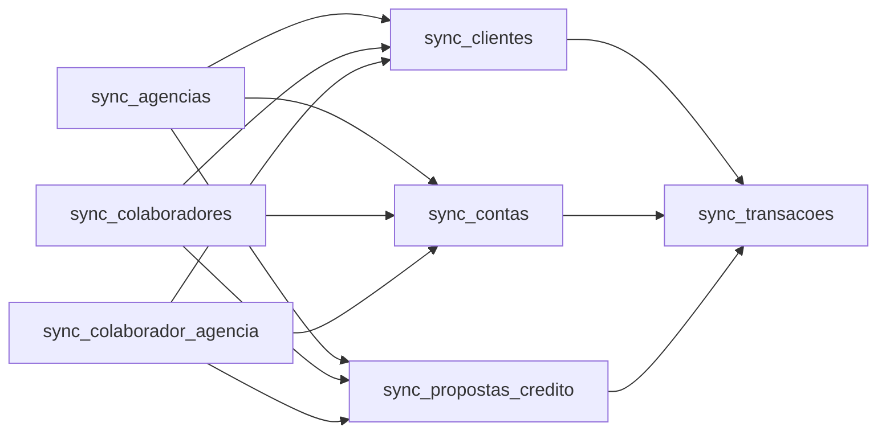

# Architecture, setup, and presentation guide

## What the project does

The project loads seven versioned CSV sources into PostgreSQL. Airflow schedules and monitors the work, Meltano runs the Singer extraction/load pipeline, and Terraform provisions the local Kubernetes platform. The extraction DAG retains the original dependency stages while using the current single `tap-csv` plugin configuration.

## Architecture

```mermaid
flowchart LR
    CSV[data/*.csv] -->|read-only Kind node bind mount| Source[/mnt/banvic-source/data]
    Airflow -->|sync_sources_then_extract| SyncPod[CSV sync pod]
    Source --> SyncPod
    SyncPod --> PVC[(meltano-data-pvc)]
    MeltanoProject[meltano/] -->|Docker build: project and plugins| Image[meltano-pipeline:v1]
    Terraform[Terraform kind root] -->|creates Kind, mounts local data, and loads image| Kind[Kubernetes / Kind]
    TerraformPlatform[Terraform platform root] -->|installs Airflow, PostgreSQL, Secrets, PVCs, RBAC| Kind
    Dags[airflow/dags/] -->|read-only bind mount| Airflow[Airflow in airflow namespace]
    Airflow -->|KubernetesPodOperator + namespace-scoped RBAC| MeltanoPods[Meltano task pods in meltano namespace]
    Image --> MeltanoPods
    PVC -->|read-only mount at /project/extract| MeltanoPods
    MeltanoPods -->|tap-csv → selected stream → target-postgres| DB[(PostgreSQL / banvic)]
    SyncPod -->|triggers after successful sync| ExtractDAG[extract_pipeline]
    SelectDAG[meltano_select standalone DAG] -->|colaboradores only| MeltanoPods
    DB -->|Banvic_Postgres connection| Airflow
```

Terraform separates the infrastructure into two roots:

1. [`terraform/kind/`](../terraform/kind/) creates the local Kind cluster and loads the locally built Meltano image. It also bind-mounts the workspace DAG folder into the Kind node.
2. [`terraform/platform/`](../terraform/platform/) installs PostgreSQL, Airflow, persistent volumes, Kubernetes Secrets, and the scoped permissions Airflow needs to create and monitor Meltano pods.

PostgreSQL, Airflow, and Meltano run in separate Kubernetes namespaces (`postgres`, `airflow`, and `meltano`). Airflow's scheduler creates task pods in the Meltano namespace; their CSV PVC is mounted read-only. Source CSVs and PostgreSQL files are stored on the Kind node, so they survive pod restarts but **not** deleting/replacing the Kind cluster.

## Extraction behavior

The `sync_sources_then_extract` DAG validates and copies current CSVs from local `data/` into `meltano-data-pvc`, then triggers `extract_pipeline`. The extraction DAG owns only the Meltano tasks and preserves this dependency graph from the original pipeline:



The standalone `meltano_select` DAG can independently load only the `colaboradores` stream. It sets the stream selection at runtime and does not modify the packaged Meltano project configuration.

Each task mounts the same Meltano project image and selects its one stream with `TAP_CSV__SELECT`, a Meltano extractor setting. The installed Meltano CLI does not accept a `--select` option on `meltano run`, so selection is passed as the extractor's environment configuration rather than inventing an unsupported CLI flag. Every run also receives a unique state suffix.

The project defines all streams and their keys in [`meltano/meltano.yml`](../meltano/meltano.yml). The CSV tap sends CSV values directly to the PostgreSQL loader. dbt is not installed or run yet; future project models belong in `meltano/transform/`.

The source-sync task validates all required local source files before copying them, and each Meltano task validates its selected file again before ingesting it. Since this workflow is manually triggered after the user updates local files, it does not need a `FileSensor`; an asynchronous source would need an arrival signal or a sensor targeting the source mount.

## Tools and decision factors

| Tool | Role here | Why it fits this project | Trade-off |
|---|---|---|---|
| Terraform | Creates the cluster and platform resources | Reproducible, reviewable infrastructure and consistent namespaces, storage, Secrets, and permissions | State contains sensitive values and must be kept private |
| Kind + Docker Desktop | Runs Kubernetes locally | Lets the project exercise actual pods, PVCs, namespaces, and RBAC without a cloud cluster | Node-local storage is not a production backup strategy |
| Apache Airflow | Orchestrates task dependencies, retries, and run visibility | The pipeline has explicit stages and benefits from a UI and task-level logs | Adds scheduler/database operational overhead compared with a simple script |
| Meltano + Singer plugins | Defines and runs extraction and loading | One declarative project holds streams, selection, schema, and plugins; avoids hand-written CSV/Postgres ingestion code | Plugin capabilities and behavior must be checked; CSV extraction is a full-file batch |
| PostgreSQL | Stores the loaded warehouse tables and Airflow metadata | Relational SQL supports joins, analysis, and downstream models | A local single-node deployment is for development, not high availability |

The Helm provider is managed by Terraform, so a separate Helm CLI installation is not needed for the documented Terraform workflow. `psql` is optional and is only needed for the interactive database-inspection step below.

## Prerequisites not installed by Terraform

Install and verify these before provisioning:

- Windows with WSL2 and an Ubuntu distribution.
- Docker Desktop using Linux containers, with WSL integration enabled for the Ubuntu distribution.
- Git, Bash, and the Docker CLI available in the Ubuntu/WSL shell.
- Terraform CLI version `1.5.0` or newer.
- `kubectl`; the configured Kubernetes cluster version is `1.36.1`.
- The `kind` CLI for refreshing kubeconfig or manually managing the cluster. Terraform's Kind provider creates the cluster, but helper instructions also use the `kind` executable.
- Internet access for Terraform provider/chart downloads and container/plugin images.
- Optional: `psql` for querying loaded tables from WSL.

Do not install Terraform providers or Helm charts manually; Terraform initializes the declared providers and manages the chart.

Use the official installation guides for the host tools:

- [Install WSL and Ubuntu](https://learn.microsoft.com/windows/wsl/install), then enable that Ubuntu distribution under Docker Desktop **Settings → Resources → WSL Integration**.
- [Install Docker Desktop](https://docs.docker.com/desktop/setup/install/windows-install/) and keep it in Linux-container mode.
- [Install Terraform on Linux](https://developer.hashicorp.com/terraform/install).
- [Install kubectl on Linux](https://kubernetes.io/docs/tasks/tools/install-kubectl-linux/).
- [Install Kind](https://kind.sigs.k8s.io/docs/user/quick-start/#installation).
- Install Git using Ubuntu's package manager (`sudo apt update && sudo apt install -y git`); Bash is included with Ubuntu.
- Install `psql` only if you want to run the database inspection queries (`sudo apt install -y postgresql-client`).

Open an Ubuntu terminal in the repository and verify the tools before provisioning:

```bash
docker version
terraform version
kubectl version --client
kind version
git --version
bash --version
```

## Configure and run

Run commands from the repository root in Ubuntu/WSL. First provision the local cluster:

```bash
terraform -chdir=terraform/kind init
terraform -chdir=terraform/kind plan
terraform -chdir=terraform/kind apply
```

Create `terraform/platform/terraform.tfvars` from the example and replace all four placeholders with unique passwords. Do not commit this file or Terraform state:

```bash
cp terraform/platform/terraform.example.tfvars terraform/platform/terraform.tfvars
terraform -chdir=terraform/platform init
terraform -chdir=terraform/platform plan -input=false
terraform -chdir=terraform/platform apply -input=false
```

Build and load the Meltano image, then configure the Kind cluster's read-only mounts for `airflow/dags/` and `data/`:

```bash
bash scripts/setup.sh
```

The script validates that all required CSV files exist, builds and loads the Meltano project image, and applies the Kind configuration. The `sync_sources_then_extract` DAG copies the current `data/*.csv` into the Meltano PVC, then triggers `extract_pipeline`. After changing input CSVs, trigger `sync_sources_then_extract` again; no image rebuild or setup-script rerun is needed. After changing Meltano project files, rerun `scripts/setup.sh` to rebuild/load the image.

Adding the `data/` bind mount to an existing Kind cluster may replace the cluster. Review the Terraform plan and back up PostgreSQL, Meltano source files, and Airflow logs before applying any plan that replaces `kind_cluster.default`. After a replacement, reapply `terraform/platform/` before running `scripts/setup.sh`; the platform resources and PVCs were inside the deleted cluster.

The loader uses the existing append behavior: rerunning ingestion can append rows already present in PostgreSQL. Replacing source files does not automatically truncate or replace target tables.

To open Airflow, run the following command and visit `http://localhost:8080`:

```bash
kubectl --kubeconfig terraform/kind/kubeconfig port-forward -n airflow svc/airflow-api-server 8080:8080
```

Trigger the manual `sync_sources_then_extract` DAG from the Airflow UI. It validates and syncs files, then triggers `extract_pipeline`. In the extraction DAG, check that the first three extraction tasks finish before the next three, and that `sync_transacoes` runs last. To load only `colaboradores`, trigger the standalone `meltano_select` DAG after the source CSVs have been synced. Task logs show file validation, Meltano invocation, and any load errors.

## Verify loaded PostgreSQL data

Once all extraction tasks succeed, inspect row counts in the seven public tables. In a second WSL terminal, run:

```bash
kubectl --kubeconfig terraform/kind/kubeconfig exec -n postgres deploy/postgres -- \
  sh -ec 'psql -U "$POSTGRES_USER" -d banvic -c "
    SELECT '\''agencias'\'' AS table_name, count(*) FROM public.agencias
    UNION ALL SELECT '\''colaboradores'\'', count(*) FROM public.colaboradores
    UNION ALL SELECT '\''colaborador_agencia'\'', count(*) FROM public.colaborador_agencia
    UNION ALL SELECT '\''clientes'\'', count(*) FROM public.clientes
    UNION ALL SELECT '\''contas'\'', count(*) FROM public.contas
    UNION ALL SELECT '\''propostas_credito'\'', count(*) FROM public.propostas_credito
    UNION ALL SELECT '\''transacoes'\'', count(*) FROM public.transacoes;
  "'
```

To demonstrate the inferred warehouse column types, run:

```bash
kubectl --kubeconfig terraform/kind/kubeconfig exec -n postgres deploy/postgres -- \
  sh -ec 'psql -U "$POSTGRES_USER" -d banvic -c "
    SELECT column_name, data_type
    FROM information_schema.columns
    WHERE table_schema = '\''public'\'' AND table_name = '\''contas'\''
    ORDER BY ordinal_position;
  "'
```

The extractor uses append-only loading, so re-running a successful full load can add duplicate rows. Use the row counts to confirm that data is present, not as fixed expected counts after multiple runs.

## Suggested presentation walkthrough

1. **Show the architecture and boundary:** explain the three namespaces and point out that source files and PostgreSQL data are stored on node-local volumes.
2. **Show infrastructure as code:** open `terraform/kind/main.tf` for the cluster/image/DAG mount; then `terraform/platform/main.tf` for namespaces, PVCs, Secrets, Airflow RBAC, and Helm values. Briefly show `init-airflow-database.sql` for separate application users/databases.
3. **Show the data project:** open `meltano/meltano.yml` and explain the seven stream definitions, runtime selection, and direct PostgreSQL loading. Show `meltano/Dockerfile` to explain why the project files are available to the task pod.
4. **Show orchestration:** open `airflow/dags/extract_pipeline_dag.py`, explain the matching dependency graph and per-task stream selection, then trigger the DAG and inspect a successful task's logs. Point out the explicit DAG ID, start date, default arguments, description, and tags in the Airflow DAG definitions.
5. **Show the result:** run the row-count and column-type queries above against `banvic`. If presenting churn/risk analysis too, run its DAG only after the load has completed and show the resulting `analise_churn` and `analise_risco` tables.

See the [Terraform platform guide](../terraform/platform/README.md), [Airflow guide](../airflow/README.md), and [Meltano project guide](../meltano/README.md) for component-specific details.
